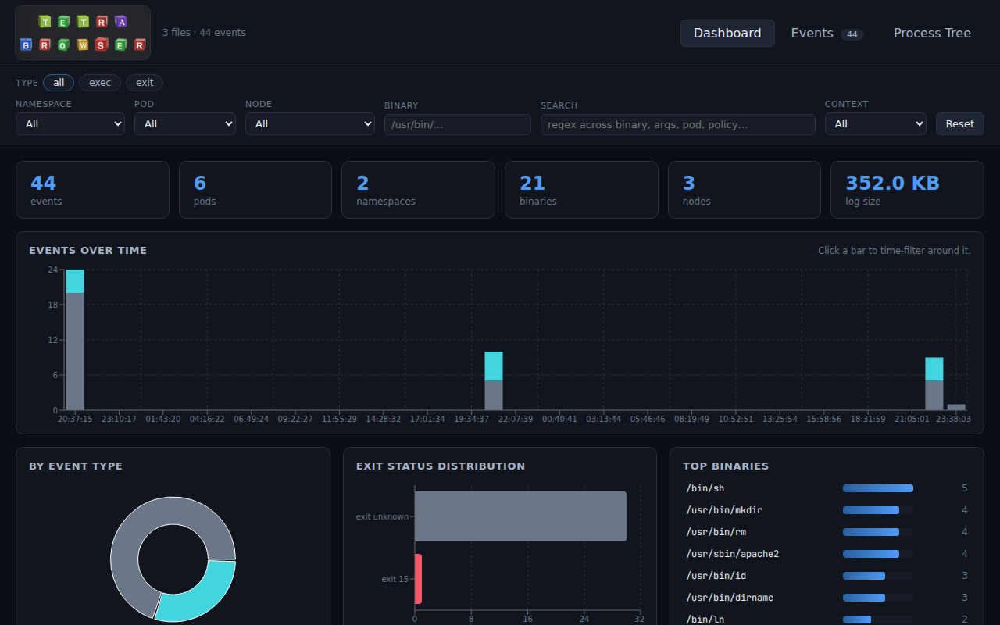
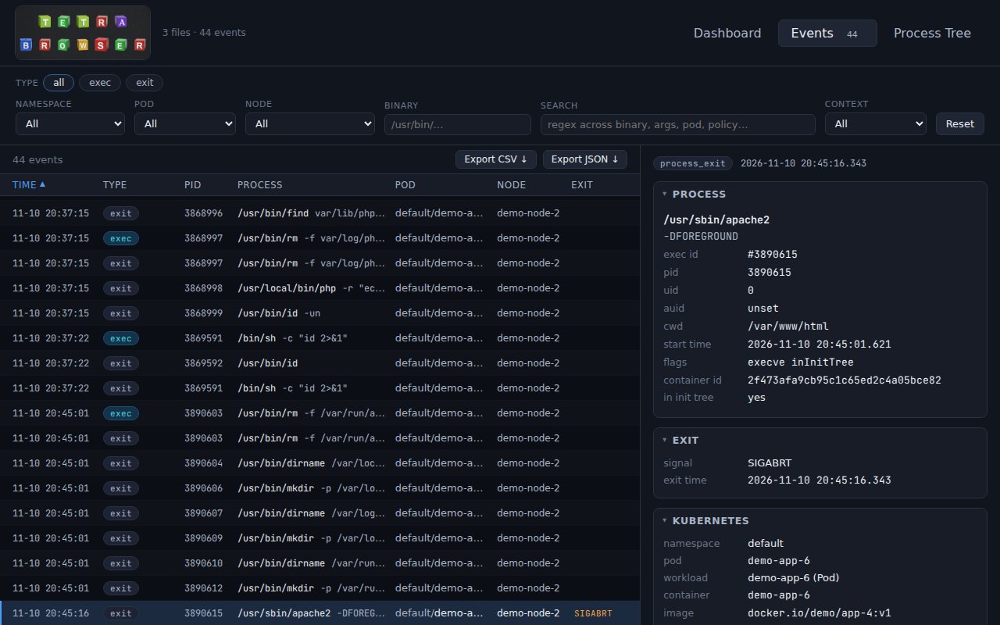
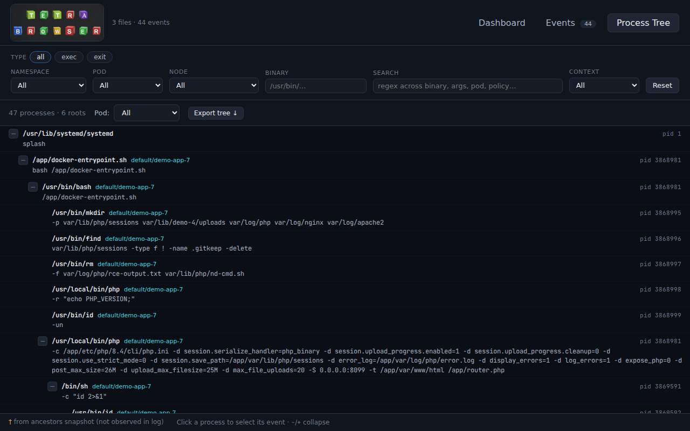

<p align="center">
  
</p>

# Tetra Browser

Tetra Browser is a GUI viewer for [Tetragon](https://tetragon.io) security event logs. You drop in one or more log files and get a filterable event table, a detail panel for every event, a reconstructed process tree and a dashboard with the usual counts and charts.

> Note: It runs entirely in the browser and the logs are never uploaded anywhere.

**Live version:** https://tb.securityin.cloud/



## Contents

- [Quick start](#quick-start)
- [Using it](#using-it)
- [Supported input](#supported-input)
- [Large files and performance](#large-files-and-performance)
- [Sample logs and anonymizing](#sample-logs-and-anonymizing)
- [Development](#development)
- [How it works](#how-it-works)
- [Deployment](#deployment)
- [Contributing](#contributing)
- [Support](#support)
- [References](#references)

## Quick start

Tetra Browser needs Node.js 22.12 or newer. Vite itself would run on 20.19, but the test runner (Vitest 5) needs 22.12.

```bash
git clone https://github.com/wand3rlust/Tetra-Browser.git
cd Tetra-Browser
npm install
npm run dev
```

Open the address the dev server prints (usually http://localhost:5173). Click **Load sample logs** to try it with the bundled data, or drop your own files onto the page. Tetra Browser works in current Chromium-based browsers and in Firefox.

There is no way to open a second set of files once a log is loaded. Reload the page to start over.

## Using it

### Loading files

Drop files on the upload area, or click it to pick them. You can select several files at once and they are merged into one list, in the order you gave them. `.json`, `.jsonl`, `.log` and `.gz` files are accepted.

Lines that cannot be parsed are skipped, not fatal. The header shows how many were skipped, and the Dashboard lists each one with its file name and line number.

### The three tabs

**Dashboard** shows the number of events, pods, namespaces, binaries and nodes in the current selection, an events-over-time chart, a breakdown by event type, the exit status distribution, and top lists for binaries, pods, policies and hook functions. Click a bar in the timeline to limit everything to that time slice. Click a binary or pod in a top list to filter by it. Clicking the same binary again removes that filter.

**Events** is a table of every event that matches the current filters. Click a column header to sort, and use the Up and Down arrow keys to move through the rows. The number on the tab always shows how many events match, whether or not a filter is active. Selecting a row opens the detail panel on the right with the process, exit status, hook, Kubernetes context, credentials and capabilities, parent and ancestors, tracing policy arguments, and the envelope. You can also open the raw JSON and copy it.



**Process Tree** rebuilds the process lineage by following `exec_id` to `parent_exec_id`. When a parent was never observed in the log, the tree falls back to the `ancestors` snapshot that Tetragon attaches to events, and marks those entries with a dagger. You can collapse branches, pick a single pod, and the lineage of the event selected in the table is highlighted.



### Filters

The filter bar applies to all three tabs. It combines these conditions, and an event must match all of them:

| Filter | What it does |
| --- | --- |
| Type chips | Show only the chosen event types |
| Namespace, Pod, Node | Pick one value from what is present in the data |
| Binary | Case-insensitive substring match on the binary path |
| Search | Regular expression over binary, arguments, pod, namespace, node, policy, function and tags. If the text is not a valid regex it is matched literally |
| Context | Only events inside pods, or only host processes |
| Time range | Set by clicking a timeline bar. Events with no usable timestamp are excluded while it is active |

**Reset** clears all of them. The Binary and Search boxes wait about 200 ms after you stop typing before they filter.

### Exporting

On the Events tab, **Export CSV** and **Export JSON** download the events that match the current filters, in the current sort order. The CSV has 18 columns (time, type, node, namespace, pod, container, image, pid, binary, arguments, cwd, flags, parent binary, exit status, function, policy, action, exec id). The JSON export is an array of the original event records. On the Process Tree tab, **Export tree** downloads the visible tree as plain text. Exports are built inside the worker and handed to the browser in pieces, so a large export does not freeze the page.

## Supported input

| Format | Notes |
| --- | --- |
| JSONL / NDJSON | One event per line. This is what Tetragon writes to `tetragon.log` and `export-stdout`. |
| JSON array | A whole-file array, compact or pretty-printed. |
| gzip | Detected from the file contents, so the extension does not matter. |
| kubectl logs | Lines that start with a Kubernetes log prefix (a timestamp and `stdout` or `stderr`) have the prefix removed. |

Parsing is lenient. A line that is not valid JSON is skipped and reported. A line that is missing only its opening `{"` is repaired and reported as recovered, because truncated first lines do show up in real exports.

All event types in Tetragon's `events.proto` are supported: `process_exec`, `process_exit`, `process_kprobe`, `process_tracepoint`, `process_uprobe`, `process_usdt`, `process_lsm`, `process_loader`, `process_throttle`, `rate_limit_info` and `test`.

## Large files and performance

Tetra Browser was built so that analysts can open very large logs. Below are the numbers from testing, run on a Ubuntu machine with 12 GB of RAM available:

| Input | Load | Filter or chart update | Notes |
| --- | --- | --- | --- |
| 100,000 events (54 MB JSONL) | about 1 s | about 0.1 s | |
| 1,000,000 events (541 MB JSONL) | about 25 s | about 0.3 to 0.5 s | Scrolling to the end of the table fills in within half a second |

Under the hood:

- JSONL is read in 16 MB pieces and never turned into one giant string, so the size of a file is limited by memory, not by the JavaScript string limit.
- All the data lives in a Web Worker. The page only receives counts, chart data, the rows currently on screen and the one event you are looking at, so the page itself stayed under 50 MB of memory in these tests.
- The event table is virtual. It only asks for the rows that are visible.

Things to know:

- JSON arrays are the weak spot. An array has to be decoded as one string, which fails above roughly 500 MB. The page then shows a warning suggesting JSONL. If you have a huge array, convert it to one event per line first.
- gzip files are unpacked in memory before parsing, so memory use depends on the uncompressed size.
- Memory use grows with the file. The 541 MB test above had 11 GB available; peak worker memory was not measured.
- The process tree shows at most 10,000 rows. When a log has more than 5,000 processes, the tree opens showing only the first two levels, with deeper branches collapsed. Expand the branches you care about, or filter first.
- Everything is held in memory. Nothing is stored on disk or kept between page loads.

To try this yourself, generate a synthetic log:

```bash
node scripts/gen-large-sample.mjs 1000000 /tmp/tetra-large.jsonl
```

## Sample logs and anonymizing

The three files in `public/samples/` are what **Load sample logs** loads, 44 events in total:

| File | Format | Events |
| --- | --- | --- |
| `tetra_sample_1.jsonl` | JSONL | 20 (9 exec, 11 exit) |
| `tetra_sample_2.json` | pretty-printed JSON array | 15 |
| `tetra_sample_3.json` | pretty-printed JSON array | 9 |

They come from a command-injection attack and have been anonymized. Node, pod, container, namespace and image names are replaced with `demo-*` names, hashes and IDs are replaced, private IP addresses become `192.0.2.x`, token arguments are masked, and CVE references are renamed. The order of events is unchanged, however, every timestamp has been changed for brevity.

`scripts/anonymize.mjs` is the script that produced them. It finds the names and IDs in the data you give it instead of using a hard-coded list, so you can use it on your own logs before sharing them:

```bash
node scripts/anonymize.mjs my-log.json other-log.json -o sanitized/
```

It keeps the input format (JSONL stays JSONL, arrays stay arrays) and writes the results into the output folder. It also moves all timestamps by one constant amount so the earliest one lands on 2026-11-01. That keeps intervals and ordering, but a log that spans more than a month will run into December.

Do note that the script is pattern-based and it cannot know everything that is sensitive in an environment. During testing, I anonymized the logs captured from my research infrastructure using this script, however, it might leave some sensitive bits in a different environment.

## Development

| Command | What it does |
| --- | --- |
| `npm run dev` | Dev server on port 5173 |
| `npm run build` | Type-checks, then builds into `dist/` |
| `npm run preview` | Serves `dist/` on port 4173 |
| `npm test` | Runs the unit tests once |
| `npm run test:watch` | Runs the tests in watch mode |

The tests live next to the parser code (`src/parser/*.test.ts`). They cover format detection and parsing (including gzip, kubectl prefixes, garbage lines and the repair of truncated lines), normalization, process tree reconstruction, the filter rules (time range edges, search, type, pod and node filters), the dashboard aggregation, and an audit that checks the sample files contain no leftover identifiers and only November 2026 timestamps.

Helper scripts are present under `scripts/`:

| Script | Usage |
| --- | --- |
| `anonymize.mjs` | `node scripts/anonymize.mjs <input.json>... -o <output-dir>` |
| `gen-large-sample.mjs` | `node scripts/gen-large-sample.mjs [eventCount] [outPath]` (defaults to 1,000,000 events in `/tmp/tetra-large.jsonl`) |
| `ui-test.mjs` | `node scripts/ui-test.mjs [port]` takes screenshots of every tab at several widths into `screenshots/` (git-ignored). Needs the dev server running and a Playwright browser (`npx playwright install chromium`). |
| `ui-audit.mjs` | `node scripts/ui-audit.mjs [port]` reports overlapping, clipped or overflowing elements. Same requirements as `ui-test.mjs`. |

Project layout:

```
src/
  parser/        parsing, normalizing, filtering, aggregation, process tree, and their tests
  workers/       the data worker, its message types, and the client the page uses to talk to it
  store/         the zustand store (filters, sort, selection, latest results)
  components/    Dashboard, EventTable, EventDetail, FilterBar, ProcessTree, Upload
  utils/         CSV helpers and file download
public/          logo, screenshots and the sample logs
scripts/         anonymizer, large-sample generator, UI test and audit scripts
```

The stack is React, Vite, TypeScript, zustand, Recharts, TanStack Virtual and pako.

## How it works

The page and the data are kept apart on purpose. A single Web Worker (`src/workers/data.worker.ts`) owns every parsed event and the process tree. The page asks it questions and gets small answers back:

```
  files --> page --parse--------> data worker
                                    reads the file in chunks, parses lines,
                                    builds one index record per event and
                                    the process tree
  page <---metadata, filter values-- worker

  filters or sort change
  page --filter(query id)--------> worker
  page <--counts, chart data, ----- worker
          sorted list of matches

  rows scrolled into view
  page --rows(event indexes)-----> worker
  page <--the row data------------- worker

  event selected, tree opened, export started
  page --raw / tree / export-----> worker
  page <--one event, a tree window, file pieces
```

A few details to keep in mind if you modify the code:

- Every filter request carries a number. If you type faster than the worker answers, the page ignores answers to anything but the newest request.
- After parsing, the worker drops the parsed objects and keeps only the original text of each line. When you open an event, that one line is parsed again. This keeps memory use down for large files.
- The filter step does everything in one pass: matching, sorting, and all the numbers the dashboard needs.
- `src/parser/filtering.ts` and `src/parser/aggregate.ts` are plain functions with no browser dependencies, which is why they are easy to unit test even though they run in the worker.
- The process tree keys on `exec_id`, which is unique per process, so reused PIDs on a long-running node cannot merge two different processes.

## Deployment

`npm run build` produces a static site in `dist/`. Any static file server can host it, and there is no backend or API. Because the tool never uploads your logs (everything is parsed in the visitor's browser), a public deployment does not expose anyone's data.

The site works at the root of a domain and under a sub-path. The build reads an optional `BASE_PATH` environment variable and the page builds its own file paths from it, so this works too:

```bash
BASE_PATH=/Tetra-Browser npm run build
```

# Contributing
To contribute simply fork this repo, make changes and create a pull request.

# Support
If you like this tool please consider giving a :star:.

## References

- [Tetragon events concept](https://tetragon.io/docs/concepts/events/)
- [events.proto](https://github.com/cilium/tetragon/blob/main/api/v1/tetragon/events.proto) and [tetragon.proto](https://github.com/cilium/tetragon/blob/main/api/v1/tetragon/tetragon.proto)
